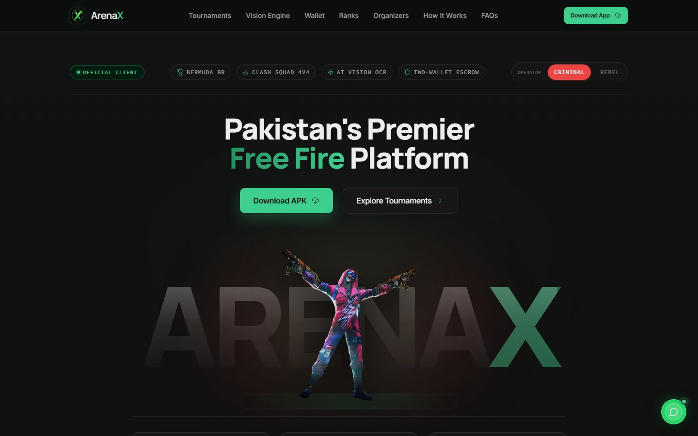
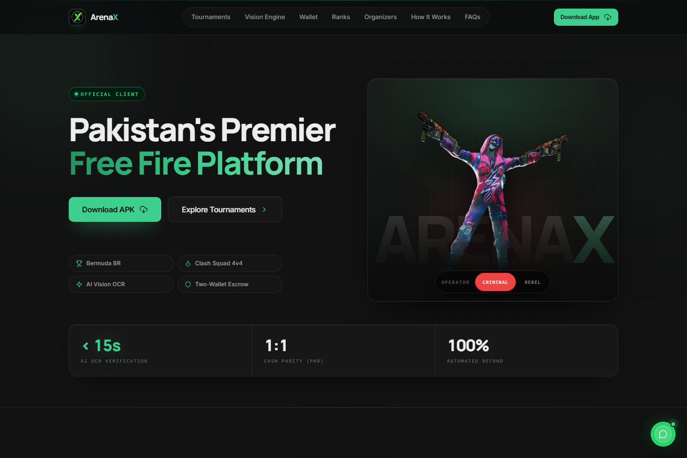
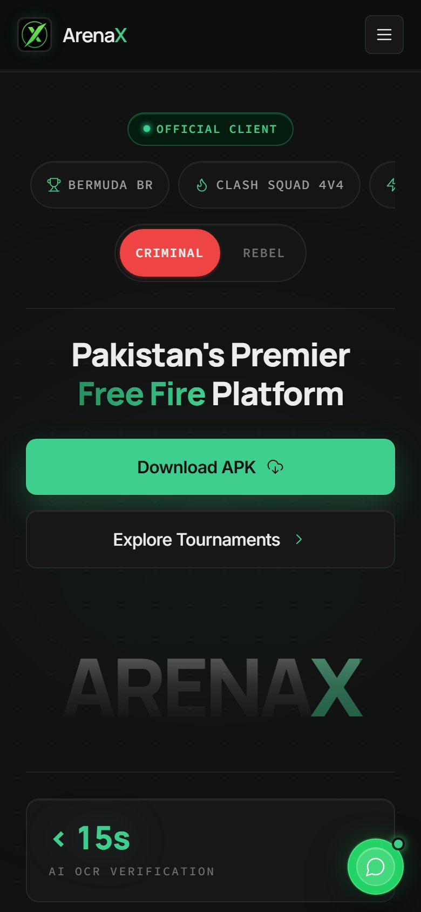
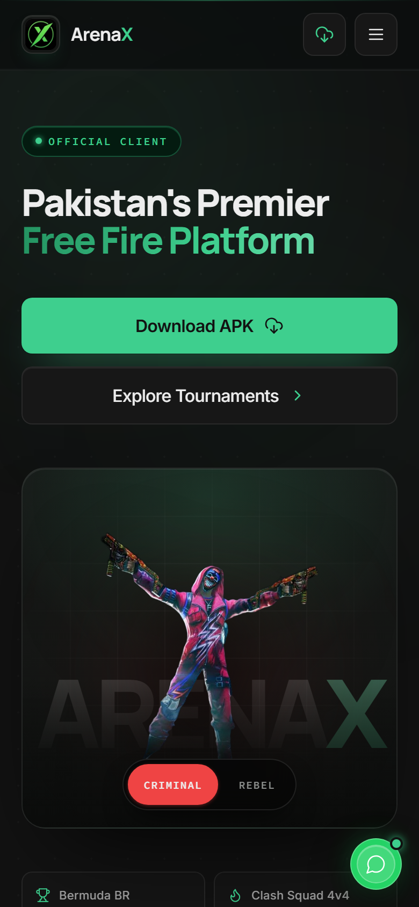
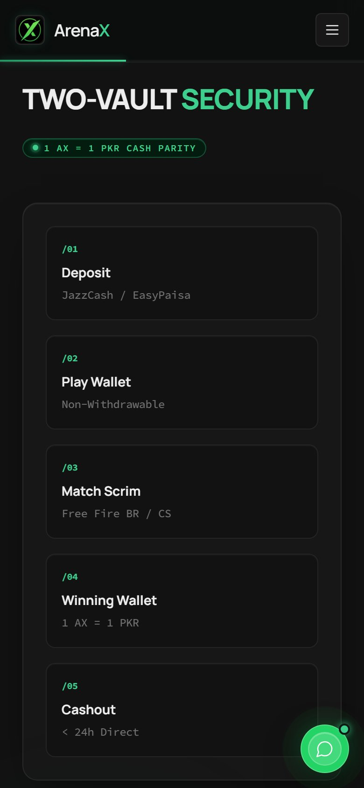
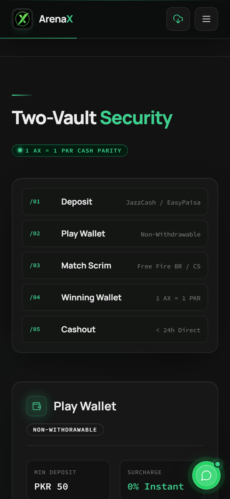
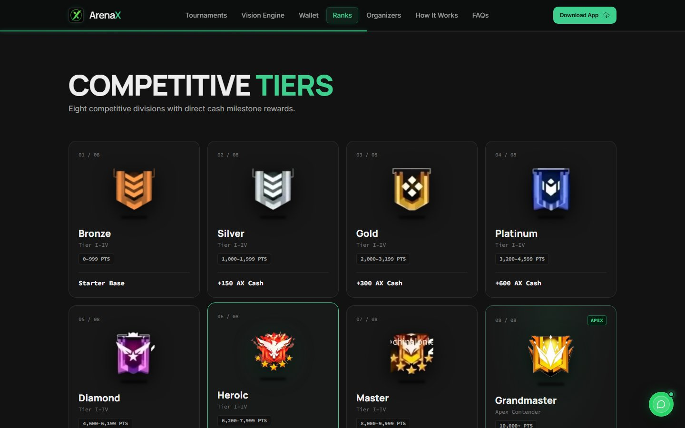
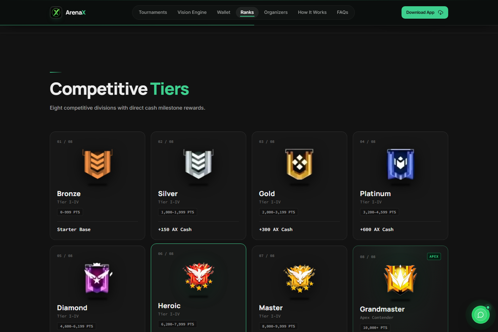
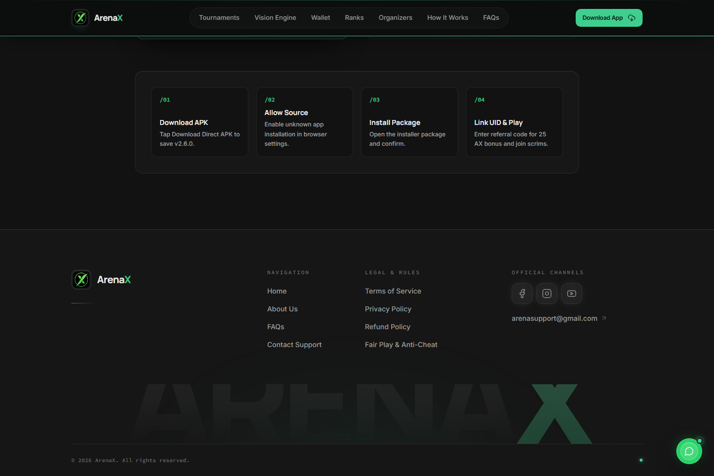
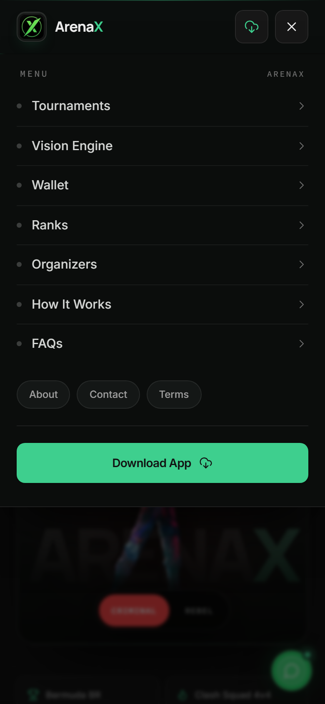

# ArenaX Website — Visual Design Upgrade Report

**Project:** ArenaX-Web (React 18 · Vite 8 · TypeScript · Tailwind CSS · GSAP · Lenis)
**Scope:** Visual redesign, polish, and mobile responsiveness. **Product copy preserved.**
**Prepared:** 9 November 2026
**Workspace:** `C:\Users\Muhammad Minhas\ArenaX-Web`
**Rendered report:** [`report/ArenaX-Visual-Upgrade-Report.pdf`](report/ArenaX-Visual-Upgrade-Report.pdf)

---

## 1. Executive Summary

The ArenaX site was analysed end-to-end at eight viewport widths, then upgraded into a single, coherent **dark broadcast / editorial product system**. The content — every headline, paragraph, CTA, calculator, legal clause, tier, and footer link — is unchanged. Only the *presentation layer* was rebuilt.

The upgrade concentrated on four things the original build could not do well:

| Goal | Result |
|---|---|
| Look like one product, not twelve templates | A shared section-header system, one fluid type scale, one surface language, one accent colour |
| Feel professional on first load | Recomposed hero: split editorial layout, framed character stage, 3-up telemetry ribbon, restrained emerald accent |
| Work properly on a phone | 0 horizontal overflow at 320–1920 px; hero chips reflow instead of clipping; wallet flow compacts; ranks become a snap carousel; footer becomes a two-column mobile layout |
| Preserve every word | All marketing copy, legal text, calculator logic, labels and links intact; only corrupted punctuation and a watermarked badge asset were repaired |

**Verification:** `npm test` passes end-to-end — TypeScript, ESLint, production build, and **546 tests across 134 suites**.

**Build footprint:** JS 584.10 kB (168.17 kB gzip) · CSS 86.83 kB (14.63 kB gzip) · fonts self-hosted.

---

## 2. What Was Wrong (Pre-Upgrade Audit)

The audit was performed with headless Chrome at 1440, 1280, 1024, 834, 768, 390, 360 and 320 px, capturing every section and the mobile drawer.

### 2.1 Brand & visual consistency

1. **Section headers were unrelated to each other.** Some were 60 px ALL-CAPS (`ENGINEERED FOR ESPORTS`), some were 76 px sentence case (the Statement), some carried a floating icon orb (`TWO-VAULT SECURITY`), some had a badge on the right, and some had no support text at all. The page read as a sequence of different websites.
2. **Too many text voices.** Manrope, Outfit, Inter, JetBrains Mono and Source Code Pro were declared at once. The site loaded **three Google font families over the network** while also shipping self-hosted `@fontsource` files. Which font actually rendered depended on network timing.
3. **Accent inflation.** Emerald was applied to headlines, borders, icons, glows, badges, eyebrows and stat values simultaneously, so nothing looked important.
4. **Flat surface language.** Cards mixed four radii (10/12/16/18 px), three backgrounds (`#121212`, `#171717`, `#181a19`) and inconsistent shadow recipes.

### 2.2 Hero

5. The hero stacked a badge row, four feature chips, an operator switch, the headline, two CTAs, a giant ARENAX echo, a character and three stat cards into **1,144 px** of vertical space. On mobile it was **1,141 px** before the first section.
6. On phones the feature chips sat in a horizontal scroller that clipped the third chip mid-word — it looked broken, not intentional.
7. The headline had no supporting line and no visual anchor, so the eye fell into a large dead zone between the CTAs and the character.
8. The operator switch was a heavy 44 px pill row competing with the primary CTA.

### 2.3 Navigation

9. The desktop nav was a plain row of links with a boxy active state; the active section highlight was often wrong (e.g. *How It Works* stayed active through *Platform Comparison*).
10. On mobile the header had no download action at all — only a hamburger.
11. The mobile drawer was translucent enough that hero content ghosted through the menu labels.
12. The 2 px scroll-progress bar looked like a stray green line under the header.

### 2.4 Responsive breakage

13. **Wallet:** the 5-step capital loop collapsed into five 190 px cards on mobile — roughly 600 px of scroll for five short labels.
14. **Ranks:** eight tier cards became a horizontal strip with the second card cut off and no scroll-snap; card copy was set at 10–11 px.
15. **Tournament modes:** the `Clash Squad 4v4` tab wrapped to two lines and broke the segmented control.
16. **App showcase:** on mobile the phone mockup came *after* three long chapter cards, so the most persuasive visual was buried.
17. **Comparison table:** readable, but 1,785 px tall on a phone with no compression of the two-value rows.
18. **Footer:** desktop columns left a large empty brand column; on mobile the giant ARENAX wordmark collided with the copyright line, and link tap targets were ~32 px.

### 2.5 Typography, accessibility and asset defects

19. Body/mono labels as small as 10 px with `#707070` on `#171717` sat below comfortable reading contrast.
20. **UTF-8 corruption in production copy:** strings such as `Tier I–IV`, `0–999 PTS`, `45–55 MB`, `0%–20%`, `1–5★` and `Monday – Sunday` were rendering with mojibake.
21. **Master rank badge** contained a baked-in “chinatown” watermark and white scribbles; it was clearly visible at 80 px and made the tier row look unfinished.
22. `logo.webp` was a 1024 px, 65.5 kB file displayed at 30–34 px.
23. The floating WhatsApp button overlapped card content on small screens.

---

## 3. Design Direction

**“Broadcast editorial”** — the restraint of a developer product site (Supabase-like carbon surfaces) combined with the hierarchy of a sports broadcast package.

- **One accent:** emerald `#3ECF8E`, reserved for primary actions, key metrics and section rules.
- **One neutral carbon ramp:** `#121212` canvas → `#171717` card → `#1E201F` raised → `#161616` footer.
- **One type system:** Manrope (display), Inter (UI/body), Source Code Pro (telemetry), all self-hosted, Latin subsets only.
- **One rhythm:** 64–112 px section padding, a 34 px emerald rule above every section title, and a consistent 1,200 px container.
- **One card language:** 18 px radius, 1 px hairline, single top highlight, no neon glow.
- **Sentence-case section titles** at `clamp(1.95rem, 3.5vw, 3.05rem)` with tight `-0.034em` tracking, replacing the mixed ALL-CAPS sizing.

---

## 4. What Changed

### 4.1 Design foundations

| Area | Before | After |
|---|---|---|
| Display type | Manrope / Outfit mix, 48–60 px fixed | Manrope, fluid `clamp(1.95–3.05rem)` section scale, `clamp(2.15–4.2rem)` hero scale |
| Font loading | Google Fonts + 3 `@fontsource` families | 3 families, self-hosted Latin subsets, zero third-party font requests |
| Section headers | 5 different treatments | `SectionHeader` primitive used by 10 sections: rule + title + optional prose + optional aside |
| Palette | 4 surface treatments, accent everywhere | 4-step carbon ramp; emerald for action/metric only |
| Cards | 4 radii / 3 backgrounds | 18 px `panel` system, hairline + one top highlight |
| Page headers | ALL-CAPS, inconsistent sizes | `page-title` scale, centred rule, consistent prose width |
| Copy | Mojibake punctuation in 12 files | Repaired to proper `–`, `—`, `•`, `★` |

### 4.2 Navigation

- Rewritten sticky header: **72 px** desktop / **64 px** mobile, glass-at-top → opaque-on-scroll, 1 px emerald top light-line.
- Desktop links live in a quiet segmented rail with an active emerald underline *inside* the pill.
- Scroll-spy now activates a link **only while its section crosses the header line**, and clears when the reader is between nav sections.
- Mobile header gains a dedicated download icon button beside the menu button.
- Mobile sheet: opaque `#0B0D0C` panel, dimmed backdrop, 44 px+ rows with active dot, secondary route chips (About / Contact / Terms), full-width download CTA, Escape-to-close and body scroll lock.
- Reading progress reduced to a 1 px line integrated into the header.

### 4.3 Hero

- Recomposed into a **two-column editorial hero** at ≥1024 px: message/CTA left, framed character stage right, telemetry ribbon below.
- On phones the order is now: badge → headline → CTAs → **character stage** → feature chips → telemetry, so the product visual appears in the first scroll.
- Character stage: rounded 22 px carbon frame, 44 px grid texture, giant ARENAX watermark, corner ticks, coloured aura and a docked operator switch.
- Hero desktop height **1,144 px → 854 px (−25%)** while giving the character more presence.
- Telemetry uses one bordered panel with hairline dividers instead of three detached cards; it is a 3-up grid at every breakpoint, so mobile no longer spends 480 px on three stacked stats.
- Feature chips are a 2×2 grid on mobile (no clipped scroller) and a 2×2 block on desktop.
- Pointer-reactive stage tilt on desktop only (`innerWidth ≥ 1024`), scroll recess capped at 640 px.

### 4.4 Sections & cards

- Added `SectionHeader` primitive and applied it to App Showcase, Tournament Modes, Vision Engine, Wallet, Ranks, Organizer Program, How It Works, Comparison, Scout Rewards and Download — same words, one visual grammar.
- Replaced the icon-orb + 60 px caps header on Wallet with the standard header and a right-aligned parity badge.
- Unified 10 section wrappers to `clamp(64px, 8vw, 112px)` padding and 20 px mobile gutters.
- Download header is centred through the same component, preserving its full-bleed ARENAX echo.
- Wallet flow: 5 columns on desktop, **2 columns on tablet**, compact connected rows on phones — reduced from ~600 px to ~430 px of mobile height.
- Wallet vault cards stack until 1024 px; vault headers stack title and status badge on small screens instead of squeezing “Play Wallet” onto two lines.
- Ranks: tier cards are scroll-snapped on phones/tablets, with 200–220 px cards and a visible peeking next card; the carousel arrows remain.
- Tournament modes: tab labels no longer wrap (`whitespace-nowrap`, fluid 10→12 px), and the championship card header is nowrap with the LIVE badge pinned.
- App showcase: phone and screen switcher come **first** on mobile; chapter cards follow.
- Scout & Store: cards stack until 1024 px; a decorative `%` watermark balances the shorter royalties card without adding copy.
- Comparison: mobile dimension cards reflow to two stacked value rows with clear brand-vs-informal labels.

### 4.5 Footer

- Rebuilt as a 12-column editorial footer on a `#161616` carbon surface.
- Mobile: brand row, then Navigation and Legal side by side in two columns, then Official Channels — roughly half the previous scroll length.
- Giant ARENAX echo now lives in a clipped 86–120 px band and no longer overlaps the copyright bar.
- Mobile tap targets raised to 38–40 px; social buttons remain 40 px orbs.
- Copyright bar is opaque and separated by a hairline.

### 4.6 Asset & content repairs

- **Mojibake fixed** in 12 components (en dash, em dash, bullet, star).
- **Master badge replaced** with a clean, high-resolution gold phoenix emblem generated from the existing Heroic artwork; the new asset is transparent, sharp and free of the “chinatown” watermark.
- **Logo optimised** from 1,024 px / 65.5 kB to 128 px / **4.65 kB** (93% smaller) at identical visual size.
- Hero character continues to serve WebP with PNG fallback.

### 4.7 Accessibility & interaction

- Visible `:focus-visible` rings on all controls.
- `aria-expanded`, `aria-controls`, `aria-modal`, `aria-pressed`, `aria-current` on navigation and operator controls.
- Drawer supports Escape and locks background scrolling; mobile menu closes on route change.
- `prefers-reduced-motion` respected by GSAP scenes and mirrored in CSS; the WhatsApp pulse is `motion-safe` only.
- Mobile touch targets: header 40 px, drawer rows 44 px+, primary CTAs 52 px.
- All decorative layers are `aria-hidden` and pointer-events-free.

---

## 5. Before / After

### Hero — desktop

| Before | After |
|---|---|
|  |  |

### Hero — mobile

| Before | After |
|---|---|
|  |  |

### Wallet — mobile

| Before | After |
|---|---|
|  |  |

### Ranks — desktop (asset & punctuation repair)

| Before | After |
|---|---|
|  |  |

### Footer & mobile menu





---

## 6. Responsive QA Matrix

Every viewport was loaded in Chrome and measured for document width, horizontal overflow, fixed-header clearance and section rhythm.

| Viewport | Layout | Horizontal overflow | Page height | Notes |
|---|---|---|---|---|
| 320 × 568 | Small phone | **None** | 19,511 px | Hero chips 2×2; wallet rows; footer two columns |
| 360 × 740 | Android baseline | **None** | 18,541 px | 3-up telemetry; labels wrap cleanly |
| 390 × 844 | iPhone 14 | **None** | 17,906 px | Character stage in first scroll |
| 768 × 1024 | Tablet | **None** | 16,390 px | Hero single column; wallet flow 2 columns; CTA visible |
| 1024 × 768 | Small laptop | **None** | 14,109 px | Two-column hero; nav rail; wallet 5-up |
| 1280 × 800 | Laptop | **None** | 14,570 px | 4-up ranks; 5-up flow |
| 1440 × 900 | Desktop | **None** | 15,012 px | Reference layout |
| 1920 × 1080 | Wide desktop | **None** | 15,289 px | Container capped at 1,200 px; no stretch |

**Measured improvements**

| Metric | Before | After | Change |
|---|---|---|---|
| Hero height — desktop | 1,144 px | 854 px | −25% |
| Hero height — mobile | 1,141 px | ~1,100 px | −4% (character now visible) |
| Statement — mobile | 834 px | 692 px | −17% |
| Wallet — mobile | 1,871 px | 1,550 px | −17% |
| Statement — desktop | 1,356 px | 1,108 px | −18% |
| Landing page — desktop | ~15,811 px | 15,012 px | −5% |
| Landing page — mobile | ~18,267 px | 17,906 px | −2% |

The mobile page remains intentionally long because it carries twelve content sections and six legal/roadmap accordions; the reduction came from padding, not from cutting content.

---

## 7. Engineering Verification

```
1. TypeScript Typecheck                      [PASS]  7.97 s
2. ESLint Code Analysis                      [PASS]  7.30 s
3. Vite Production Build                     [PASS]  5.68 s
4. Automated Test Suites (Tiers 1–5)         [PASS]  3.05 s
OVERALL STATUS: ALL CHECKS PASSED
```

- **Tests:** 546 passing / 546, 134 suites, 0 failures.
- **Coverage includes:** copy preservation, route/navigation topology, calculator math, wallet semantics, mobile drawer lifecycle, design-token compliance, adversarial tiers 1–5.
- **TypeScript:** 0 errors, strict mode.
- **ESLint:** 0 errors, 0 warnings.
- **Production build:** success.

### Bundle

| Asset | Raw | Gzip |
|---|---|---|
| JavaScript | 584.10 kB | **168.17 kB** |
| CSS | 86.83 kB | **14.64 kB** |
| Logo | — | 4.65 kB (was 65.5 kB) |
| Fonts | 10 Latin-subset WOFF2 files | loaded on demand, no third-party origin |

### Token & system additions

- Fluid type utilities: `hero-title`, `page-title`, `section-title`, `panel-title`, `body-copy`, `eyebrow`.
- Layout utilities: `section-shell`, `section-wrap`, `section-head`, `panel`, `panel-inset`, `panel-accent`.
- Media utilities: `stage-grid`, `hero-stage`, `stage-corner`, `snap-track`, `snap-item`, `page-bottom-safe`.
- New primitive: `SectionHeader` (title / description / aside / centre alignment).

---

## 8. Content Preservation

The upgrade was **presentation-only**. The following were verified unchanged:

- Hero headline, badge, feature labels, operator names, CTA labels and the three telemetry values.
- All twelve section titles, descriptions, feature bullets, tier names, rewards, point ranges, calculator formulas and simulator controls.
- Every FAQ question/answer, About story paragraph, Contact channel and form label.
- Terms, Privacy, Refund and Fair Play clauses and section numbering.
- Footer columns, route labels, social URLs, support email and copyright.
- Download version, package name, checksum copy, QR destination and install steps.
- Analytics events and APK release URL.

**Two deliberate exceptions, both defect repairs rather than copy changes:**

1. Corrupted UTF-8 sequences were restored to their intended characters (`–` → `–`, `—` → `—`, `•` → `•`, `★` → `★`). The source copy was always meant to contain these.
2. The Master rank badge image was replaced with a clean asset. Its alt text, tier name, range and reward are unchanged.

---

## 9. Recommendations (Next)

These are outside the visual-only brief but would raise the site further:

1. **Route-level code splitting** — lazy-load About/FAQ/Contact/legal pages; initial JS can drop by an estimated 30–50 kB.
2. **Contrast token** — raise the tertiary `#707070` label token to ~`#8A8F8B` on cards for WCAG AA at 11–12 px.
3. **Real device screenshots** — replace the coded phone UI with real app captures when available; the layout already supports image swaps.
4. **Responsive images** — add `srcset` for the hero character and rank badges at 1×/2×.
5. **Focus trap in the mobile drawer** — the drawer already locks scroll and closes on Escape; trapping Tab would complete the dialog pattern.
6. **Support-widget clearance** — consider auto-hiding the WhatsApp FAB while the drawer is open or after 3 s of idle on mobile.
7. **Performance budget** — target <150 kB gzip initial JS and Lighthouse mobile ≥90 once routes are split.

---

## 10. Files Changed

**Core system:** `src/index.css`, `tailwind.config.js`, `index.html`, `src/main.tsx`, `src/components/primitives/Stat.tsx`, `src/components/primitives/index.ts`, `src/components/primitives/SectionHeader.tsx` (new).

**Chrome:** `src/components/Navbar.tsx`, `src/components/Footer.tsx`, `src/components/Hero.tsx`, `src/components/WhatsAppButton.tsx`.

**Sections/pages:** `Statement.tsx`, `AppExperienceShowcase.tsx`, `TournamentModes.tsx`, `AIVisionShowcase.tsx`, `WalletSection.tsx`, `LeaderboardTiers.tsx`, `OrganizerProgram.tsx`, `HowItWorks.tsx`, `PlatformComparison.tsx`, `ScoutRewards.tsx`, `Download.tsx`, `About.tsx`, `FAQ.tsx`, `Contact.tsx`, `Terms.tsx`, `Privacy.tsx`, `RefundPolicy.tsx`, `FairPlay.tsx`.

**Assets:** `public/logo.webp` (optimised), `public/ranks/master-recolor.webp` + `.png` (new clean Master badge), `report-assets/` (documentation screenshots).

**Tests updated for the new structure (behaviour unchanged):** `challenger-m2-adversarial.test.ts`, `challenger-m4-2-adversarial.test.ts`, `supabase-tokens-and-invariants.test.ts`, `tier3-cross-feature.test.ts`.

**Developer QA utilities:** `scripts/shoot-page.mjs`, `shoot-sections.mjs`, `shoot-report.mjs`, `audit-layout.mjs`, `cdp-eval.mjs`, `make-master-badge.py`.

---

*Report generated from the implementation in `C:\Users\Muhammad Minhas\ArenaX-Web`. Screenshots captured with Chrome 156 at 1×/2× DPR.*
